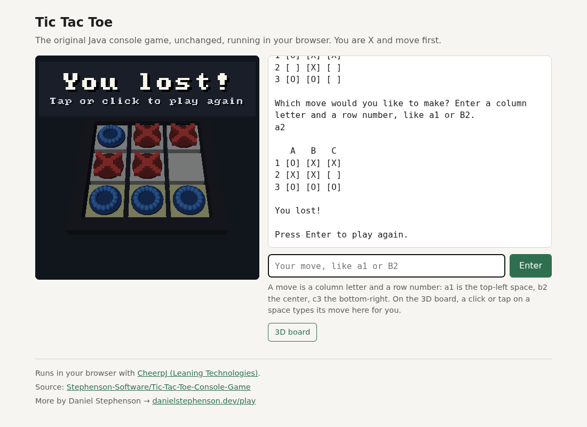

# Tic Tac Toe Console Game

[](https://danielstephenson.dev/play/tic-tac-toe-console-game)

This application allows the user to play Tic Tac Toe against the computer.

## Play in your browser
The game can be played at <https://tic-tac-toe-java.play.danielstephenson.dev>, and is listed with
the other browser games at <https://danielstephenson.dev/play>. It runs the same Java classes in the
browser with [CheerpJ](https://cheerpj.com) (Leaning Technologies), loaded from CheerpJ's official
CDN under its Community License.

The browser build lives in `web/`:

- `web/java/BrowserMain.java` is a browser-only entry point. CheerpJ offers no interactive
  standard input, so it replaces `System.in` and `System.out` with streams backed by two JavaScript
  functions on the page, then plays `TicTacToe` unchanged, offering a new game after each result.
  It does not start usage reporting, so the browser build never reports.
- `web/index.html` shows the game's output, and a text field with an Enter button feeds each move
  to `System.in`. Beside them is the 3D board (below).
- `web/build.sh` compiles `src/` and `BrowserMain` with `--release 8` (CheerpJ's default Java
  runtime is Java 8) into `build/web/tic-tac-toe.jar`, and copies the page, the 3D board's two
  scripts and Strata's grid relay (`build/web/strata/`, from `web/fetch-strata.sh`) next to it.

### The 3D board



The console stays the game. Beside it, the page shows the board in 3D, drawn by
[Strata](https://github.com/Preponderous-Software/strata)'s grid relay: nine tiles in a frame,
each `X` a red cross of blocks and each `O` a ring of blue beads, with the console's column
letters and row numbers beside them.

- The 3D board only mirrors the game: `web/board3d-scene.js` reads the last board the game
  printed (and any result line after it) from the game's output, never from what was typed.
- A click or tap on a tile types that space's move (`a1` to `c3`) into the console, through the
  same path as the text field's Enter button, and echoes it in the terminal. Every move therefore
  still goes through the game's own input: a taken space is refused with `That space is taken!`
  exactly as if it had been typed. After a result, the board shows it on a card above the tiles
  (the winning line lit), and a click or tap anywhere on the board presses Enter for the next game.
- Typing still works in 3D: the text field and Enter button are unchanged, and the tile a typed
  move names is lit while it is typed. The board takes no keys of its own.
- 3D is the default where it can run. The relay's module (about 1.3 MB) is downloaded only when
  the 3D board is wanted, only when it fits a 4 MB limit, and only where the browser has WebGL 2;
  otherwise the page stays text only and says why under the console. The `3D board` button hides
  and shows it (remembered on the device), and `?view=2d` or `?view=3d` in the address picks one
  for a visit; `?view=2d` never downloads the relay.
- On a phone the board sits above the console, full width, and taps play it.

`web/fetch-strata.sh` downloads Strata 0.9.1's `strata-0.9.1-wasm32-emscripten.tar.gz`, checks it
against the release's `SHA256SUMS`, and copies `kit/grid-relay/dist/`'s five files and Strata's
MIT `LICENSE` into `build/strata/` (kept between builds). `STRATA_DOWNLOADS=<dir>` takes the
download and `SHA256SUMS` from a directory instead, for building offline.

To try it locally, run `./web/build.sh`, serve `build/web` (for example with
`python3 -m http.server 8000 --directory build/web`) and open <http://localhost:8000>.

The 3D board's scene is checked under Node's own test runner (no dependencies), against the game's
real output: reading boards and results from it, the move typed for each tile, picking the tile
under a press at desktop and phone sizes, and the relay messages:

```
node --test web/test/*.test.cjs
```

`web/e2e/board3d.cjs` plays the built site in headless Chromium with the real Java game under
CheerpJ and the real relay (WebGL 2 on SwiftShader), at a desktop size and on a phone (390 x 844,
touch): clicks and taps play games to a result, a taken tile is refused by the game, typing still
plays, the board button hides and shows the board mid-game, `?view=2d` never downloads it, and a
browser without WebGL 2 stays text only and says why:

```
npm install --no-save playwright && npx playwright install chromium
node web/e2e/board3d.cjs build/web <screenshot directory>
```

The `Browser build` workflow (`.github/workflows/browser.yml`) builds and checks the site, runs
both of these, on every
pull request, every push to `master` and every manual run. It deploys the site to arcade, versioned
as `version.txt` plus the commit, on a manual run, or on a push to `master` when the repository
variable `ARCADE_ENABLED` is `true`.

## Requirements
A JDK is required, not just a JRE, since the sources are compiled with `javac`. Java 8
or newer is needed, because the vendored usage-reporting client (`src/TraceClient.java`)
uses lambdas. No build system, and no third-party dependency, is used by this project.

## Building
The sources live flat in `src/` in the default package and are compiled with a
single command:

```
javac -d out src/*.java
```

The `out/` directory is ignored by `.gitignore`, so compiled classes are never
committed.

## Testing
The rules of the board — every winning line, the tie condition, and how a column
letter and row number pick a space — are checked by `test/ThreeByThreeGridTest.java`.
The usage-reporting switch — that every opt-out, including a near-miss spelling or
an unreadable settings file, turns reporting off and is left as written — is checked
by `test/UsageReportingTest.java`, which sends nothing anywhere. Both are plain
classes with no test framework. They are compiled together with the sources and
run directly, and each exits with a non-zero status if any check fails:

```
javac -d out src/*.java test/*.java
java -cp out ThreeByThreeGridTest
java -cp out UsageReportingTest
```

The GitHub Actions workflow in `.github/workflows/ci.yml` runs on every push to
`master` and every pull request. It runs the build command above, then these three
commands, and then plays three bounded games
from piped input: a smoke test, one that checks an uppercase move is played in the
right column and that malformed moves are rejected rather than crashing the game, and
one whose input runs out mid-game, which must end cleanly.

## Running
The entry point is the `Driver` class:

```
java -cp out Driver
```

## How to play
The player is `X` and always moves first; the computer is `O` and picks an unoccupied
space at random. The board is printed before every prompt:

```
   A   B   C
1 [ ] [ ] [ ]
2 [ ] [ ] [ ]
3 [ ] [ ] [ ]
```

Each turn is prompted with `Which move would you like to make? Enter a column letter
and a row number, like a1 or B2.` A move is entered as a column letter followed by a
row number, with no space between them — `a1` is the top-left space, `b2` the center, `c3` the bottom-right. Column
letters are accepted in either case, so `B2` and `b2` are the same move.

Anything else — a single character, a letter other than `a`-`c`, a row other than
`1`-`3`, or extra characters such as `a1x` — is rejected: `That is not a valid move.
Enter a column letter and a row number, like a1 or B2.` is printed and the board is
shown again. If an occupied space is chosen, `That space is taken! Choose another one.`
is printed and the board is shown again.

The game ends as soon as a line of three is completed or the board fills, and one of
`You won!`, `You lost!`, or `It was a tie!` is printed with the final board.

## Known limitations
- No quit command is offered; a game in progress is left by interrupting the process,
  or by ending input — `Ctrl+D`, or a piped script running out of moves — which prints
  `Input ended before the game was finished.` and exits normally. A game left that way
  has no result, so no `game-finished` usage event is sent for it.
- Only `ThreeByThreeGrid` and `UsageReporting` have automated tests. `TicTacToe` reads from `System.in`
  and moves with an unseeded `Random`, so it is checked only by the CI games, which
  verify that a game runs to a result line, how move input is parsed, and that
  running out of input ends a game cleanly — not which moves the computer makes or
  who wins.

## Usage reporting
Usage reporting is on by default: each run sends a `startup` event carrying the game's name and version, and, once a game ends with a result, a `game-finished` event carrying only the version and the result (`won`, `lost` or `tie`), to the maintainers' [trace](https://github.com/Stephenson-Software/trace) service at `https://trace.danielstephenson.dev`, so that it is known whether anybody plays it. Each event also carries a random installation ID (the tag `install`), so installations can be counted rather than events. Nothing else is sent: no moves, usernames, hostnames, IP addresses, paths or anything typed at the prompt. The reports are sent from a background thread and dropped, not retried, if the service cannot be reached; at most a few seconds are waited for them when the game exits. The first run that reports prints a one-line notice and writes `~/.config/tic-tac-toe-console-game/usage-reporting.properties`.

The installation ID is a random UUID written to `~/.config/tic-tac-toe-console-game/trace-install-id`, next to the settings file, the first time reporting runs, and reused after that. It identifies no person, account or address. Delete the file to get a new one, or set `TRACE_INSTALL_ID` in the environment to pin one. Every opt-out below also stops it: when reporting is off, no ID is made up and the file is neither read nor written. The browser build does not report at all, so it has no ID.

To turn it off, any one of these is enough:

- `enabled=false` in `~/.config/tic-tac-toe-console-game/usage-reporting.properties`
- `TRACE_USAGE_REPORTING=off` in the environment — the switch every trace client honours, checked before the settings file
- `DO_NOT_TRACK=1` in the environment, per [consoledonottrack.com](https://consoledonottrack.com)

Every switch fails closed. `enabled` keeps reporting on only when it is `true`, `on`, `yes` or `1` (or the line is missing); `false`, `off`, `no`, `0`, a blank value or a typo turn it off, and so does a settings file that is there but cannot be read. `TRACE_USAGE_REPORTING` set to anything but blank, `true`, `on`, `yes` or `1` turns reporting off, and so does `DO_NOT_TRACK` set to anything but blank, `0`, `false`, `off` or `no`. The game never rewrites an existing settings file. Other spellings count as off too: `enable=false`, `Enabled=false`, `usage_reporting.enabled=false` or `usage-reporting=false`, and `disabled=true`, even next to `enabled=true`.

The key in `src/UsageReporting.java` is the write key issued to this game; it can only add usage events and is not secret. The CI workflow sets `TRACE_USAGE_REPORTING=off`, so a CI run never reports.

Details on what trace collects and why: https://danielstephenson.dev/usage-reporting

## License
This project is released under the Stephenson Software Non-Commercial License. See
[LICENSE](LICENSE) for the full text.
